<div align="center">

# Moroccan Prepaid Churn — End-to-End MLOps Pipeline

**Predict which prepaid subscribers are about to leave. Every step from raw CSV to a monitored API is reproducible, and the evaluation is free of leakage.**

[](https://github.com/SouhailBourhim/Moroccan_Prepaid_Churn_End_to_End_MLOps_Pipeline/actions/workflows/ci.yml)


[Overview](#why-this-project) · [Findings](#what-the-data-says) · [Architecture](#architecture) · [Evaluation](#a-leak-free-evaluation-protocol) · [Dashboard](#operations-dashboard) · [API](#serving-api) · [Quick start](#quick-start)

</div>

---

## Why this project

Prepaid subscribers sign no contract and give no notice. They just stop recharging. A retention team that knows *who* is drifting away can send an offer before the SIM goes silent.

This repository builds that system end to end:

| Area | What it covers |
|---|---|
| **Two markets** | Trains on the real **Expresso** dataset (Senegal, 2.15M subscribers, 18.75% churn) and on a **CTGAN-generated Moroccan** dataset (2M subscribers, 2.7% churn) calibrated to ANRT 2023 market figures. |
| **Engineered signal** | 9 sklearn transformers turn heavy missingness into features. A missing value often *means* "never used this service". |
| **Four candidates** | Logistic Regression, XGBoost, LightGBM, CatBoost, compared with stratified CV. Optuna tunes the boosters. |
| **Leak-free evaluation** | The holdout is split off before anything is fit. Early stopping, calibration and thresholds never see the rows they are scored on. |
| **Production surface** | FastAPI with calibrated probabilities, API-key auth, rate limiting, a prediction log, and feature *and* prediction drift detection. |
| **Operations dashboard** | A React UI for live scoring, traffic monitoring and drift alerts. |
| **Reproducible** | `dvc repro` rebuilds both datasets' pipelines; MLflow records every run; CI lints, type-checks, tests, builds the dashboard and smoke-tests the Docker image. |

> **About the Moroccan data.** Morocco has no public prepaid churn dataset. The Moroccan set is Expresso's joint distribution, shifted to a 2.7% churn prior and relabelled with Moroccan regions, operators, packs and MAD amounts. It exercises the pipeline on Moroccan-shaped data. It is **not** evidence about how Moroccan subscribers actually behave, and the results say so.

---

## What the data says

These figures come from the EDA and feature-engineering notebooks, run on the real Expresso training data.

### Engagement is the dominant signal

<p align="center">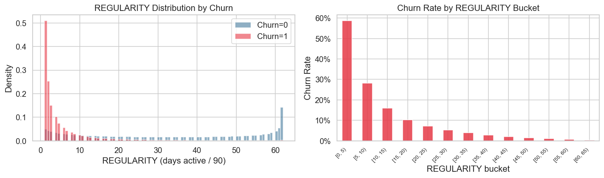</p>

`REGULARITY` counts the days a subscriber was active out of 90. Subscribers active fewer than 5 days churn at **almost 60%**. Above 40 days, churn practically disappears. That single column has a Spearman ρ of 0.53 with churn.

### Missing data is not noise; it is behaviour

<p align="center">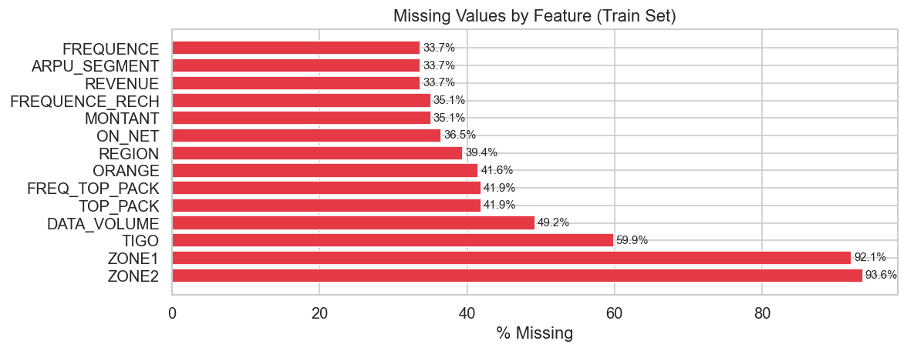</p>

Between a third and nearly all values are missing in most usage columns. They are missing *because the subscriber never used that service* (missing not at random), so imputing them away would throw information out. The pipeline first records a `{col}_missing` flag, then imputes.

<p align="center">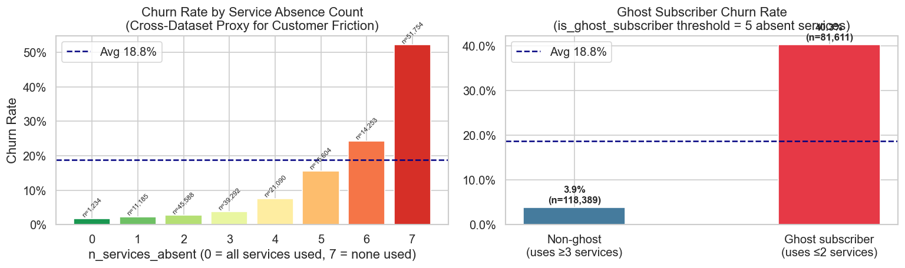</p>

Counting the absent services gives one of the strongest engineered features. Subscribers missing from all 7 channels churn at over **50%**. "Ghost subscribers", absent from 5 or more channels, churn at 40% against 3.9% for everyone else.

### Feature engineering multiplies the usable signal

<p align="center">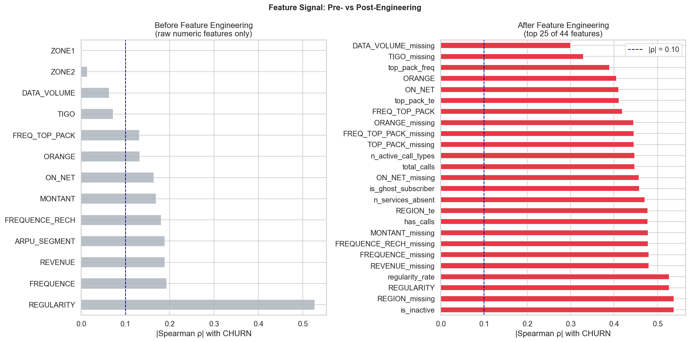</p>

Before engineering, only `REGULARITY` correlates strongly with churn. Afterwards, each of the top 25 features reaches |ρ| ≈ 0.3 or more: missingness flags, service counts, call totals and target encodings.

<details>
<summary><b>Cross-dataset check: which signals generalise beyond Senegal?</b></summary>

<p align="center">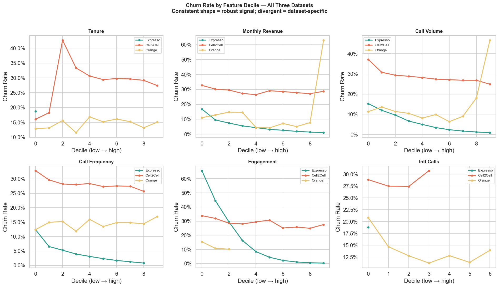</p>

Expresso was compared with two reference datasets, Cell2Cell (USA) and Orange Telecom (USA). Churn falls with engagement and call volume in both Expresso and Cell2Cell. Tenure and international calls behave differently in every dataset. The details are in `notebooks/04_cross_dataset_analysis.ipynb`.

</details>

---

## Architecture

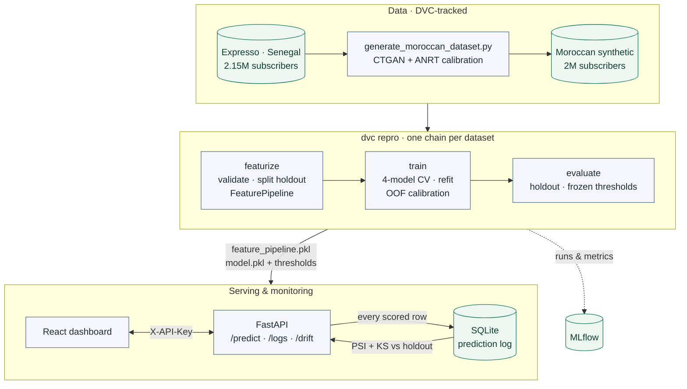

### Feature pipeline

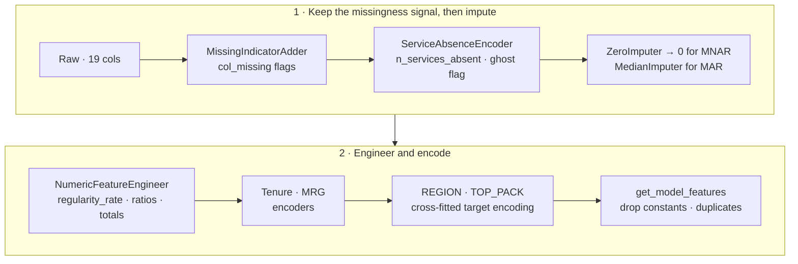

Every transformer is sklearn-compatible and is fit on the training split only. Target encoders are **cross-fitted**: each training row is encoded with statistics from the other folds, so its own label never leaks into its features. Feature pruning is data-driven, so the same code works for both datasets.

---

## A leak-free evaluation protocol

A churn model is only as trustworthy as its holdout score. Every step below is built so that no number is measured on rows that helped produce it:

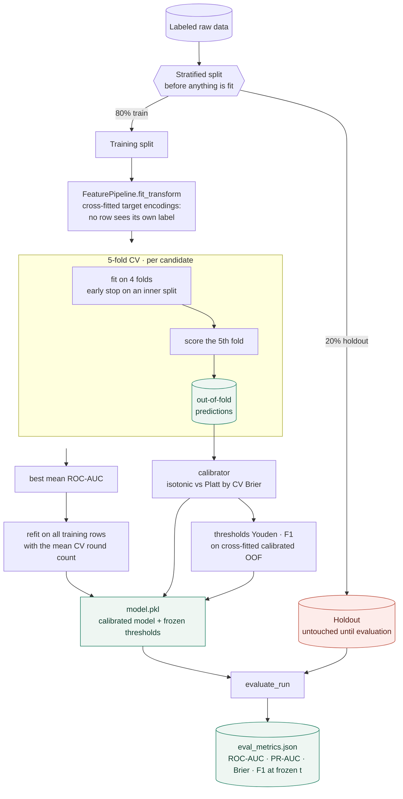

Each design choice closes a specific leak:

| Design choice | Leak it closes |
|---|---|
| Split the holdout off before fitting anything | The model being scored on rows it trained on |
| Cross-fitted target encoding | A row's own label leaking into `REGION_te` / `top_pack_te` |
| Early stopping on an inner split | The number of trees being tuned on the fold that is then scored |
| Calibrator fit on out-of-fold scores | Calibration learned from over-confident in-sample scores |
| Thresholds chosen on OOF, then frozen | F1, precision and recall quietly tuned on the test set |

The candidates are trained with class weighting (`scale_pos_weight ≈ 36` on Moroccan data). That ranks subscribers well but inflates the probabilities. Calibration maps them back, so a score of 0.30 means about a 30% churn rate.

### Results

All numbers below come from `dvc repro` under the protocol above. The holdout rows were never used for training, early stopping, calibration or threshold selection. Full details are in `models/{dataset}/eval_metrics.json` and `training_manifest.json`.

**Holdout performance of the served model** (XGBoost + isotonic calibration on both datasets):

| Metric | Expresso (real) | Moroccan (synthetic) |
|---|---|---|
| Holdout size · churn rate | 430,810 · 18.75% | 400,000 · 2.70% |
| ROC-AUC | **0.9316** | **0.9226** |
| PR-AUC | **0.703** (base rate 0.188) | **0.320** (base rate 0.027) |
| Brier (calibrated) | **0.0815** | **0.0213** |
| Brier (uncalibrated) | 0.1130 | 0.1142 |
| Brier (always predict the base rate) | 0.1524 | 0.0263 |
| F1-optimal threshold (frozen in training) | 0.343 | 0.179 |
| F1 · precision · recall at that threshold | 0.699 · 0.609 · 0.820 | 0.374 · 0.303 · 0.491 |

Calibration is what makes the probabilities usable. On the Moroccan data, the class-weighted model's raw scores have a *worse* Brier score than simply predicting 2.7% for everyone. After isotonic calibration, a predicted 30% means about 30% of those subscribers churn.

**Model comparison (5-fold CV on the training split):**

| Model | Expresso ROC-AUC | Expresso PR-AUC | Moroccan ROC-AUC | Moroccan PR-AUC |
|---|---|---|---|---|
| XGBoost | **0.9314** ± 0.0004 | 0.707 | **0.9216** ± 0.0013 | 0.316 |
| LightGBM | 0.9314 ± 0.0004 | 0.706 | 0.9202 ± 0.0014 | 0.318 |
| CatBoost | 0.9314 ± 0.0004 | 0.707 | 0.9198 ± 0.0015 | 0.301 |
| Logistic Regression | 0.9284 ± 0.0003 | 0.689 | 0.8981 ± 0.0016 | 0.170 |

The three boosted models are statistically tied on Expresso. Even logistic regression comes within 0.003 ROC-AUC, which shows how much of the signal the feature engineering captures.

> **Before this protocol.** An earlier version reported an Expresso "holdout" ROC-AUC of 0.933. It had been scored on rows the model was trained on. Removing the leaks moved ranking metrics only slightly (0.933 → 0.932). The bigger gains came from calibration and from frozen thresholds. Those numbers are kept in [`models/legacy/`](models/legacy/README.md) for reference.
>
> The Moroccan scores are not comparable to Expresso's in a meaningful way: that dataset is synthetic, derived from Expresso. Its lower PR-AUC reflects its 2.7% base rate; ROC-AUC does not depend on prevalence.

---

## Operations dashboard

A Vite + React + TypeScript dashboard sits on top of the API.

> **These screenshots come from a local demo.** The model was trained on synthetic sample data (`tests/conftest.make_raw_frame`), not the real datasets. 1,150 subscribers were scored, including a 250-subscriber cohort whose activity was forced to near zero, to show the drift detector at work.

<table>
<tr>
<td width="38%" valign="top">

**Live scoring.** Edit a subscriber, score it, or queue a batch. The threshold slider starts at the model's trained F1-optimal threshold.

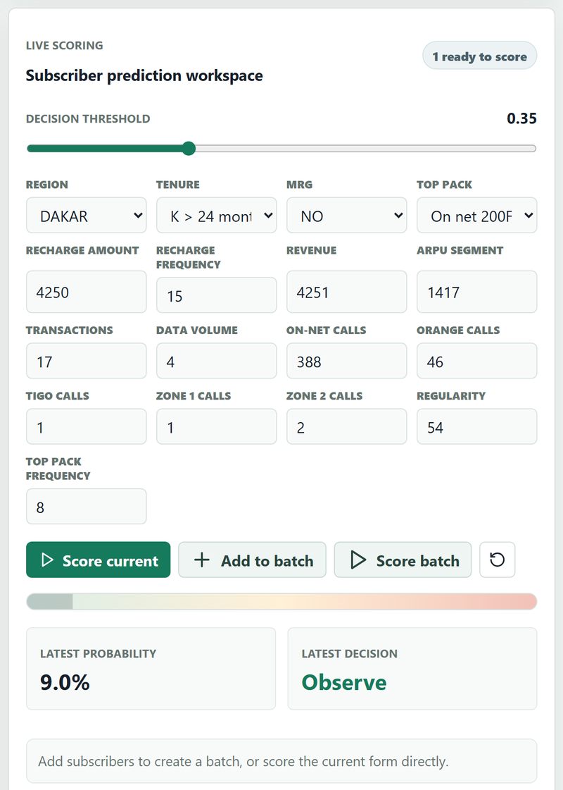

</td>
<td width="62%" valign="top">

**Prediction log.** Traffic statistics for the selected window and the latest scored rows, each with the caller's `subscriber_id` so delayed churn labels can be joined back later.

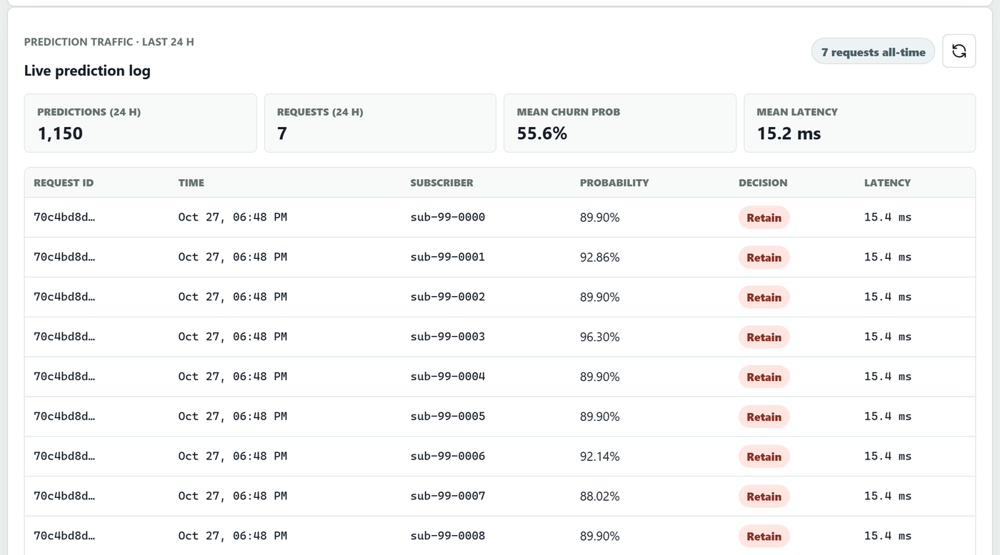

**Drift detection.** Every model feature, *and the served probability itself*, is compared against the holdout baseline. The low-activity cohort shows up exactly where it should: `regularity_rate`, `is_inactive` and `churn_probability` drift, while everything else stays OK.

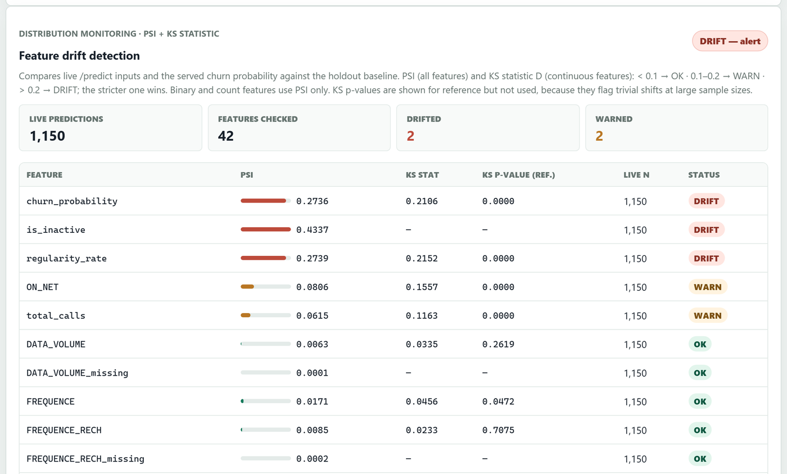

</td>
</tr>
</table>

<details>
<summary><b>Why the drift detector uses effect sizes, not p-values</b></summary>

With thousands of live rows, a Kolmogorov–Smirnov p-value flags shifts far too small to matter. Testing about 40 features at p < 0.05 would also raise a false WARN on almost every report. So the status is driven by:

| Metric | Applies to | OK | WARN | DRIFT |
|---|---|---|---|---|
| PSI | every feature | < 0.1 | 0.1–0.2 | > 0.2 |
| KS statistic *D* | continuous features | < 0.1 | 0.1–0.2 | > 0.2 |

Binary flags and small counts are binned on their own values and judged by PSI alone. The baseline is the holdout, because it went through exactly the serving transform.

</details>

---

## Serving API

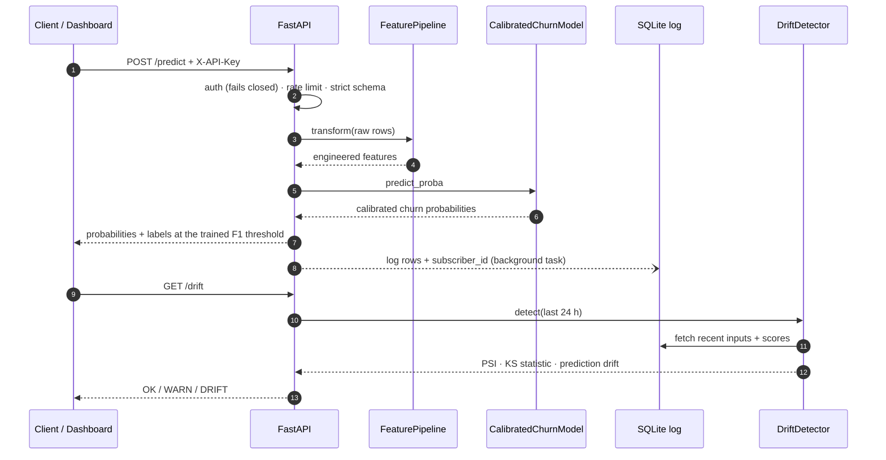

<p align="center">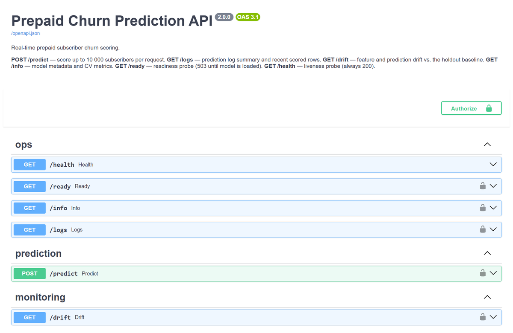</p>

| Endpoint | Method | What it does |
|---|---|---|
| `/health` | GET | Liveness probe. Always 200, no auth. |
| `/ready` | GET | Readiness probe. 503 until the model is loaded. |
| `/info` | GET | Model, dataset, calibration method, default threshold, CV metrics |
| `/predict` | POST | Scores 1–10,000 subscribers with calibrated probabilities; every row is logged |
| `/logs` | GET | All-time totals, stats for the last `hours`, and the most recent rows |
| `/drift` | GET | Feature drift and prediction drift against the holdout baseline |

```bash
curl -X POST http://localhost:8000/predict \
  -H "Content-Type: application/json" -H "X-API-Key: $CHURN_API_KEY" \
  -d '{"subscribers": [{
        "subscriber_id": "sub-000123",
        "REGION": "DAKAR", "TENURE": "K > 24 month", "MRG": "NO",
        "REGULARITY": 54.0, "ON_NET": 388.0, "REVENUE": 4251.0
      }]}'
```

```json
{
  "request_id": "6f1c…",
  "predictions": [{"subscriber_id": "sub-000123", "churn_probability": 0.049, "churn_prediction": false}],
  "model_name": "catboost",
  "threshold": 0.38,
  "n_subscribers": 1
}
```

<details>
<summary><b>Hardening details</b></summary>

- **Strict inputs.** Unknown or misspelled fields, negative amounts, and unknown `TENURE` or `MRG` values are rejected with 422, never silently treated as missing.
- **Auth fails closed.** With neither `CHURN_API_KEYS` nor `CHURN_AUTH_DISABLED=1` set, protected endpoints return 503. Keys are compared in constant time.
- **Rate limiting.** Limits are per client per 60 s. `X-Forwarded-For` is only trusted from `CHURN_TRUSTED_PROXIES`. Memory is bounded, and limits are divided across `API_WORKERS`.
- **Prediction log.** SQLite in WAL mode, written after the response is sent, with configurable retention. In Docker it lives on a named volume, so monitoring survives restarts.

All settings are listed in [`.env.example`](.env.example).

</details>

---

## Quick start

```bash
# 1. Install
python -m venv .venv && source .venv/bin/activate
pip install -e ".[dev]"

# 2. Get the raw data (or put Expresso Train.csv / Test.csv in data/raw/expresso/)
dvc pull

# 3. Generate the Moroccan dataset (CTGAN: ~15 min on GPU, ~2 h on CPU)
python generate_moroccan_dataset.py --n-rows 2000000 --epochs 300
#    or a fast fallback without CTGAN (real rows, no duplicates, capped at ~1.8M)
python generate_moroccan_dataset.py --no-ctgan

# 4. Featurize → train → evaluate, for both datasets
dvc repro

# 5. Serve (local dev: auth explicitly disabled)
CHURN_AUTH_DISABLED=1 uvicorn src.api.app:app --port 8000 --reload

# 6. Dashboard → http://localhost:5173
cd dashboard && npm install && npm run dev
```

**With Docker:**

```bash
cp .env.example .env        # set CHURN_API_KEYS
docker compose up --build
```

Model artifacts are mounted read-only, not baked into the image. To shrink the image, install only the winning model's library: `MODEL_EXTRAS=api,serve-xgboost docker compose build`.

<details>
<summary><b>Running stages one by one</b></summary>

```bash
python -m src.features.run_pipeline --dataset expresso        # or moroccan
python -m src.models.train         --dataset expresso
python -m src.models.evaluate_run  --dataset expresso
python -m src.models.tune          --dataset moroccan --model xgboost --trials 50
python -m src.models.predict       --dataset expresso          # batch-score Test.csv

dvc dag                 # see the pipeline
dvc metrics show        # training manifests + holdout metrics
mlflow ui --backend-store-uri sqlite:///mlruns.db
```

`tune` writes the best parameters to `configs/{dataset}.yaml`. It never writes a model; retrain (`dvc repro`) so the tuned parameters go through the same CV, refit and calibration path as every other model.

</details>

---

## The Moroccan synthetic dataset

| Parameter | Value | Source |
|---|---|---|
| Churn rate | 2.7% / month | Moroccan industry estimate |
| Target ARPU | 27.5 MAD | ANRT 2023 |
| 4G data penetration | 74% | ANRT 2023 |
| Operators | Inwi 35.3% · Maroc Telecom 32.5% · Orange 32.2% | ANRT 2023 |
| Regions | 12 cities, population-weighted | 2024 estimates |

1. CTGAN learns the joint distribution of an Expresso sample.
2. It samples about 2.5M synthetic rows.
3. Post-processing recalibrates units and markets. **REGION** and **TOP_PACK** use a churn-rate-ordered mapping, so each Moroccan city and pack gets exactly its target share while keeping the churn signal of the Expresso category it replaces. OPERATOR and MRG are random and carry no signal. New 4G users are drawn mostly from active subscribers.
4. Classes are resampled to the 2.7% churn prior.

---

## Quality

```bash
pytest                                  # 100+ tests
ruff check src/ tests/ && mypy src/     # lint + strict typing
cd dashboard && npm run lint && npm run build
```

The test suite includes:

- an **end-to-end train → evaluate run** on synthetic data
- `/predict` through a **real** fitted pipeline and calibrated model
- drift checks showing that tiny shifts at large sample sizes stay OK while real shifts are flagged
- auth, rate-limit spoofing, and strict-validation cases

<details>
<summary><b>Project structure</b></summary>

```
configs/                 base.yaml + per-dataset overlays (expresso.yaml, moroccan.yaml)
generate_moroccan_dataset.py
data/raw/                DVC-tracked CSVs
data/features/{dataset}/ train / holdout / score parquet, feature_pipeline.pkl
models/{dataset}/        model.pkl, training_manifest.json, eval_metrics.json
models/legacy/           pre-fix metrics (reference only)
src/
  utils/config.py        load_config(dataset), dataset_paths(dataset), MLflow setup
  data/                  typed loaders, validation
  features/              FeaturePipeline, run_pipeline
  models/                fitting, train, calibrate, tune, evaluate, artifacts, predict
  api/                   app, schemas, auth, rate_limit, logger
  monitoring/drift.py    PSI + KS statistic, prediction drift
dashboard/               React operations dashboard
notebooks/               01–04 EDA · 05 feature engineering · 06 evaluation
docs/                    PROJECT.md (full technical doc), ADRs, images
```

</details>

---

## Roadmap

- [x] Leak-free evaluation, OOF calibration, frozen thresholds
- [x] Calibrated serving, auth, rate limiting, prediction log
- [x] Feature and prediction drift monitoring
- [ ] **Ground-truth feedback loop:** join delayed churn labels on `subscriber_id` and track production ROC-AUC and Brier
- [ ] **Automated retraining** when drift or production metrics cross a threshold, promoted through the MLflow registry
- [ ] Shared (Redis) rate-limit store for multi-replica deployments
- [ ] Cloud deployment (Azure Container Apps / AKS / Render)

---

<div align="center">

**Datasets:** [Zindi Expresso Churn](https://zindi.africa/competitions/expresso-churn-prediction) · [Kaggle Cell2Cell](https://www.kaggle.com/datasets/jpacse/datasets-for-churn-telecom) · [Kaggle Orange Telecom](https://www.kaggle.com/datasets/mnassrib/telecom-churn-datasets)

Full technical documentation: [`docs/PROJECT.md`](docs/PROJECT.md) · Model selection rationale: [`docs/adr/001-model-selection.md`](docs/adr/001-model-selection.md)

</div>
